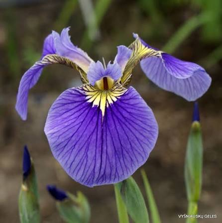
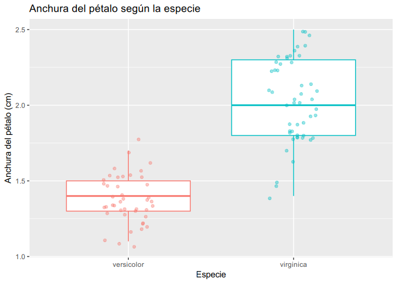
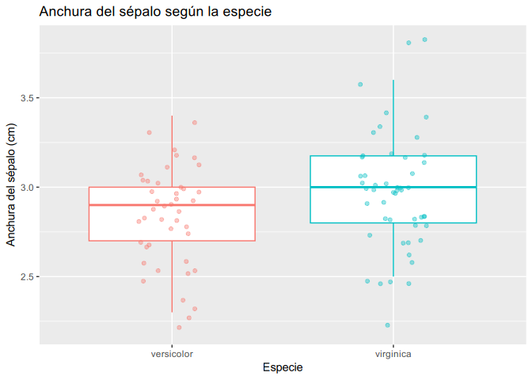
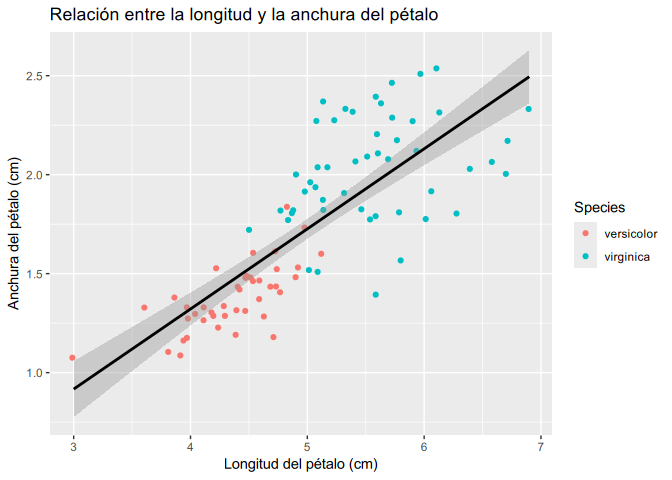

IRIS DATA
================
María González Martín
2026-11-18

Elaboraremos un informe reproducible utilizando **R Markdown** y el
conjunto de datos *iris*.

Para realizar este informe utilizaremos los paquetes *dplyr*, *ggplot2*
y *knitr*.

En primer lugar, crea un nuevo archivo de referencias bibliográficas en
formato **BibTeX**, utilizando el código que hemos visto en clase.
Guarda el archivo con el nombre `libraries.bib`.

# Encabezado YAML

El encabezado YAML del documento se encuentra al principio del archivo.

# Opciones globales de código

Las opciones globales de los bloques de código R se han establecido en
el bloque inicial “setup”.

# Conocimiento del conjunto de datos e introducción

El conjunto de datos `iris` contiene 150 observaciones correspondientes
a tres especies de iris: *Iris setosa*, *Iris versicolor* e *Iris
virginica*. Se han medido cuatro características de las flores,
expresadas en centímetros: longitud y anchura del sépalo (*Sepal.Length*
y *Sepal.Width*) y longitud y anchura del pétalo (*Petal.Length* y
*Petal.Width*). Hay 50 observaciones de cada especie.

A continuación se muestran imágenes de las tres especies:

<figure>

<figcaption aria-hidden="true">Iris setosa</figcaption>
</figure>

<figure>

<figcaption aria-hidden="true">Iris versicolor</figcaption>
</figure>

<figure>

<figcaption aria-hidden="true">Iris virginica</figcaption>
</figure>

# Exploración inicial de los datos. Código R en línea

El conjunto de datos `iris` contiene 5 variables y 150 observaciones.

Las medias de las variables numéricas son las siguientes:

- La media de la longitud del sépalo (*Sepal.Length*) es 5.8433333 cm.
- La media de la anchura del sépalo (*Sepal.Width*) es 3.0573333 cm.
- La media de la longitud del pétalo (*Petal.Length*) es 3.758 cm.
- La media de la anchura del pétalo (*Petal.Width*) es 1.1993333 cm.

# Tabla de datos

La siguiente tabla muestra los diez primeros registros del conjunto de
datos `iris`.

| Sepal.Length | Sepal.Width | Petal.Length | Petal.Width | Species |
|:------------:|:-----------:|:------------:|:-----------:|:-------:|
|     5.1      |     3.5     |     1.4      |     0.2     | setosa  |
|     4.9      |     3.0     |     1.4      |     0.2     | setosa  |
|     4.7      |     3.2     |     1.3      |     0.2     | setosa  |
|     4.6      |     3.1     |     1.5      |     0.2     | setosa  |
|     5.0      |     3.6     |     1.4      |     0.2     | setosa  |
|     5.4      |     3.9     |     1.7      |     0.4     | setosa  |
|     4.6      |     3.4     |     1.4      |     0.3     | setosa  |
|     5.0      |     3.4     |     1.5      |     0.2     | setosa  |
|     4.4      |     2.9     |     1.4      |     0.2     | setosa  |
|     4.9      |     3.1     |     1.5      |     0.1     | setosa  |

Tabla 1. Primeros diez registros del conjunto de datos iris

# Manipulación de datos

Creamos un nuevo conjunto de datos que contiene únicamente las
observaciones cuya anchura del pétalo es mayor que 1.

    ##    Sepal.Length Sepal.Width Petal.Length Petal.Width    Species
    ## 1           7.0         3.2          4.7         1.4 versicolor
    ## 2           6.4         3.2          4.5         1.5 versicolor
    ## 3           6.9         3.1          4.9         1.5 versicolor
    ## 4           5.5         2.3          4.0         1.3 versicolor
    ## 5           6.5         2.8          4.6         1.5 versicolor
    ## 6           5.7         2.8          4.5         1.3 versicolor
    ## 7           6.3         3.3          4.7         1.6 versicolor
    ## 8           6.6         2.9          4.6         1.3 versicolor
    ## 9           5.2         2.7          3.9         1.4 versicolor
    ## 10          5.9         3.0          4.2         1.5 versicolor
    ## 11          6.1         2.9          4.7         1.4 versicolor
    ## 12          5.6         2.9          3.6         1.3 versicolor
    ## 13          6.7         3.1          4.4         1.4 versicolor
    ## 14          5.6         3.0          4.5         1.5 versicolor
    ## 15          6.2         2.2          4.5         1.5 versicolor
    ## 16          5.6         2.5          3.9         1.1 versicolor
    ## 17          5.9         3.2          4.8         1.8 versicolor
    ## 18          6.1         2.8          4.0         1.3 versicolor
    ## 19          6.3         2.5          4.9         1.5 versicolor
    ## 20          6.1         2.8          4.7         1.2 versicolor
    ## 21          6.4         2.9          4.3         1.3 versicolor
    ## 22          6.6         3.0          4.4         1.4 versicolor
    ## 23          6.8         2.8          4.8         1.4 versicolor
    ## 24          6.7         3.0          5.0         1.7 versicolor
    ## 25          6.0         2.9          4.5         1.5 versicolor
    ## 26          5.5         2.4          3.8         1.1 versicolor
    ## 27          5.8         2.7          3.9         1.2 versicolor
    ## 28          6.0         2.7          5.1         1.6 versicolor
    ## 29          5.4         3.0          4.5         1.5 versicolor
    ## 30          6.0         3.4          4.5         1.6 versicolor
    ## 31          6.7         3.1          4.7         1.5 versicolor
    ## 32          6.3         2.3          4.4         1.3 versicolor
    ## 33          5.6         3.0          4.1         1.3 versicolor
    ## 34          5.5         2.5          4.0         1.3 versicolor
    ## 35          5.5         2.6          4.4         1.2 versicolor
    ## 36          6.1         3.0          4.6         1.4 versicolor
    ## 37          5.8         2.6          4.0         1.2 versicolor
    ## 38          5.6         2.7          4.2         1.3 versicolor
    ## 39          5.7         3.0          4.2         1.2 versicolor
    ## 40          5.7         2.9          4.2         1.3 versicolor
    ## 41          6.2         2.9          4.3         1.3 versicolor
    ## 42          5.1         2.5          3.0         1.1 versicolor
    ## 43          5.7         2.8          4.1         1.3 versicolor
    ## 44          6.3         3.3          6.0         2.5  virginica
    ## 45          5.8         2.7          5.1         1.9  virginica
    ## 46          7.1         3.0          5.9         2.1  virginica
    ## 47          6.3         2.9          5.6         1.8  virginica
    ## 48          6.5         3.0          5.8         2.2  virginica
    ## 49          7.6         3.0          6.6         2.1  virginica
    ## 50          4.9         2.5          4.5         1.7  virginica
    ## 51          7.3         2.9          6.3         1.8  virginica
    ## 52          6.7         2.5          5.8         1.8  virginica
    ## 53          7.2         3.6          6.1         2.5  virginica
    ## 54          6.5         3.2          5.1         2.0  virginica
    ## 55          6.4         2.7          5.3         1.9  virginica
    ## 56          6.8         3.0          5.5         2.1  virginica
    ## 57          5.7         2.5          5.0         2.0  virginica
    ## 58          5.8         2.8          5.1         2.4  virginica
    ## 59          6.4         3.2          5.3         2.3  virginica
    ## 60          6.5         3.0          5.5         1.8  virginica
    ## 61          7.7         3.8          6.7         2.2  virginica
    ## 62          7.7         2.6          6.9         2.3  virginica
    ## 63          6.0         2.2          5.0         1.5  virginica
    ## 64          6.9         3.2          5.7         2.3  virginica
    ## 65          5.6         2.8          4.9         2.0  virginica
    ## 66          7.7         2.8          6.7         2.0  virginica
    ## 67          6.3         2.7          4.9         1.8  virginica
    ## 68          6.7         3.3          5.7         2.1  virginica
    ## 69          7.2         3.2          6.0         1.8  virginica
    ## 70          6.2         2.8          4.8         1.8  virginica
    ## 71          6.1         3.0          4.9         1.8  virginica
    ## 72          6.4         2.8          5.6         2.1  virginica
    ## 73          7.2         3.0          5.8         1.6  virginica
    ## 74          7.4         2.8          6.1         1.9  virginica
    ## 75          7.9         3.8          6.4         2.0  virginica
    ## 76          6.4         2.8          5.6         2.2  virginica
    ## 77          6.3         2.8          5.1         1.5  virginica
    ## 78          6.1         2.6          5.6         1.4  virginica
    ## 79          7.7         3.0          6.1         2.3  virginica
    ## 80          6.3         3.4          5.6         2.4  virginica
    ## 81          6.4         3.1          5.5         1.8  virginica
    ## 82          6.0         3.0          4.8         1.8  virginica
    ## 83          6.9         3.1          5.4         2.1  virginica
    ## 84          6.7         3.1          5.6         2.4  virginica
    ## 85          6.9         3.1          5.1         2.3  virginica
    ## 86          5.8         2.7          5.1         1.9  virginica
    ## 87          6.8         3.2          5.9         2.3  virginica
    ## 88          6.7         3.3          5.7         2.5  virginica
    ## 89          6.7         3.0          5.2         2.3  virginica
    ## 90          6.3         2.5          5.0         1.9  virginica
    ## 91          6.5         3.0          5.2         2.0  virginica
    ## 92          6.2         3.4          5.4         2.3  virginica
    ## 93          5.9         3.0          5.1         1.8  virginica

Agrupamos las observaciones por especie y calculamos el número de
individuos de cada una.

    ## # A tibble: 2 × 2
    ##   Species        N
    ##   <fct>      <int>
    ## 1 versicolor    43
    ## 2 virginica     50

En el conjunto de datos filtrado hay 43 individuos de la especie
*versicolor* y 50 individuos de la especie *virginica*.

# Test estadístico y representación gráfica

Utilizamos el conjunto de datos obtenido en la pregunta anterior para
comparar las medias de las dos especies mediante dos test t para
muestras independientes.

## Comparación de la anchura del pétalo

**Hipótesis:**

- H0: la media de la anchura del pétalo es igual en las dos especies.
- H1: la media de la anchura del pétalo es diferente en las dos
  especies.

Realizamos el test t:

    ## 
    ##  Welch Two Sample t-test
    ## 
    ## data:  petalo by especies
    ## t = -14.149, df = 80.179, p-value < 2.2e-16
    ## alternative hypothesis: true difference in means between group versicolor and group virginica is not equal to 0
    ## 95 percent confidence interval:
    ##  -0.7379210 -0.5559395
    ## sample estimates:
    ## mean in group versicolor  mean in group virginica 
    ##                  1.37907                  2.02600

El p-valor obtenido es 1.677685^{-23}.

<!-- -->

Con un nivel de significación del 5 %, se rechaza la hipótesis nula.
Existen diferencias estadísticamente significativas entre las medias de
las dos especies.

## Comparación de la anchura del sépalo

**Hipótesis:**

- H0: la media de la anchura del sépalo es igual en las dos especies.
- H1: la media de la anchura del sépalo es diferente en las dos
  especies.

Realizamos el test t:

    ## 
    ##  Welch Two Sample t-test
    ## 
    ## data:  sepalo by especies
    ## t = -2.2419, df = 90.999, p-value = 0.0274
    ## alternative hypothesis: true difference in means between group versicolor and group virginica is not equal to 0
    ## 95 percent confidence interval:
    ##  -0.26237841 -0.01585415
    ## sample estimates:
    ## mean in group versicolor  mean in group virginica 
    ##                 2.834884                 2.974000

El p-valor obtenido es 0.0274004.

<!-- -->

Con un nivel de significación del 5 %, se rechaza la hipótesis nula.
Existen diferencias estadísticamente significativas entre las medias de
las dos especies.

# Modelización y representación gráfica

Estudiamos la relación entre la longitud del pétalo (*Petal.Length*) y
su anchura (*Petal.Width*) utilizando el conjunto de datos obtenido en
la pregunta 6.

## Representación gráfica

## Modelo de regresión lineal

Ajustamos un modelo de regresión lineal simple, considerando la anchura
del pétalo como variable dependiente y la longitud del pétalo como
variable independiente.

    ## 
    ## Call:
    ## lm(formula = Petal.Width ~ Petal.Length, data = datos_filtrados)
    ## 
    ## Residuals:
    ##     Min      1Q  Median      3Q     Max 
    ## -0.5688 -0.1832 -0.0237  0.1549  0.6335 
    ## 
    ## Coefficients:
    ##              Estimate Std. Error t value Pr(>|t|)    
    ## (Intercept)  -0.29715    0.16819  -1.767   0.0806 .  
    ## Petal.Length  0.40463    0.03324  12.174   <2e-16 ***
    ## ---
    ## Signif. codes:  0 '***' 0.001 '**' 0.01 '*' 0.05 '.' 0.1 ' ' 1
    ## 
    ## Residual standard error: 0.2455 on 91 degrees of freedom
    ## Multiple R-squared:  0.6196, Adjusted R-squared:  0.6154 
    ## F-statistic: 148.2 on 1 and 91 DF,  p-value: < 2.2e-16

El coeficiente de regresión de la variable *Petal.Length* es 0.4046317.

El R² es 0.6195844.

> También podemos redondearlo mediante `round` e indicando el número de
> decimales
>
> El coeficiente de regresión de la variable *Petal.Length* es 0.405.
>
> El R² es 0.62.

# Referencias bibliográficas

Para elaborar este informe se ha utilizado el software R ([R Core Team
2026](#ref-R-base)) y los paquetes *dplyr* ([Wickham, François, et al.
2026](#ref-R-dplyr)), *ggplot2* ([Wickham, Chang, et al.
2026](#ref-R-ggplot2)) y *knitr* ([Xie 2025](#ref-R-knitr)).

# Información de la sesión

A continuación se muestra la información de la sesión de R utilizada
para generar el documento.

    ## R version 4.5.3 (2026-03-11)
    ## Platform: x86_64-pc-linux-gnu
    ## 
    ## Matrix products: default
    ## BLAS:   /usr/local/lib64/R-4.5.3/lib/libRblas.so 
    ## LAPACK: /usr/local/lib64/liblapack.so.3.10.1  LAPACK version 3.10.1
    ## 
    ## locale:
    ##  [1] LC_CTYPE=es_ES.UTF-8       LC_NUMERIC=C              
    ##  [3] LC_TIME=es_ES.UTF-8        LC_COLLATE=es_ES.UTF-8    
    ##  [5] LC_MONETARY=es_ES.UTF-8    LC_MESSAGES=es_ES.UTF-8   
    ##  [7] LC_PAPER=es_ES.UTF-8       LC_NAME=C                 
    ##  [9] LC_ADDRESS=C               LC_TELEPHONE=C            
    ## [11] LC_MEASUREMENT=es_ES.UTF-8 LC_IDENTIFICATION=C       
    ## 
    ## time zone: NA
    ## tzcode source: system (glibc)
    ## 
    ## attached base packages:
    ## [1] datasets  utils     grDevices graphics  stats     methods   base     
    ## 
    ## other attached packages:
    ## [1] knitr_1.51    ggplot2_4.0.3 dplyr_1.2.1  
    ## 
    ## loaded via a namespace (and not attached):
    ##  [1] vctrs_0.7.2        nlme_3.1-169       cli_3.6.5          rlang_1.2.0       
    ##  [5] xfun_0.57          otel_0.2.0         generics_0.1.4     S7_0.2.1          
    ##  [9] labeling_0.4.3     glue_1.8.0         htmltools_0.5.9    scales_1.4.0      
    ## [13] rmarkdown_2.31     grid_4.5.3         evaluate_1.0.5     tibble_3.3.1      
    ## [17] fastmap_1.2.0      yaml_2.3.12        lifecycle_1.0.5    compiler_4.5.3    
    ## [21] RColorBrewer_1.1-3 pkgconfig_2.0.3    mgcv_1.9-4         rstudioapi_0.18.0 
    ## [25] lattice_0.22-9     farver_2.1.2       digest_0.6.39      R6_2.6.1          
    ## [29] utf8_1.2.6         tidyselect_1.2.1   splines_4.5.3      pillar_1.11.1     
    ## [33] magrittr_2.0.5     Matrix_1.7-5       withr_3.0.2        tools_4.5.3       
    ## [37] gtable_0.3.6

R Core Team. 2026. *R: A Language and Environment for Statistical
Computing*. Vienna, Austria: R Foundation for Statistical Computing.
<https://www.R-project.org/>.

Wickham, Hadley, Winston Chang, Lionel Henry, Thomas Lin Pedersen,
Kohske Takahashi, Claus Wilke, Kara Woo, Hiroaki Yutani, Dewey
Dunnington, and Teun van den Brand. 2026. *Ggplot2: Create Elegant Data
Visualisations Using the Grammar of Graphics*.
<https://ggplot2.tidyverse.org>.

Wickham, Hadley, Romain François, Lionel Henry, Kirill Müller, and Davis
Vaughan. 2026. *Dplyr: A Grammar of Data Manipulation*.
<https://dplyr.tidyverse.org>.

Xie, Yihui. 2025. *Knitr: A General-Purpose Package for Dynamic Report
Generation in r*. <https://yihui.org/knitr/>.

